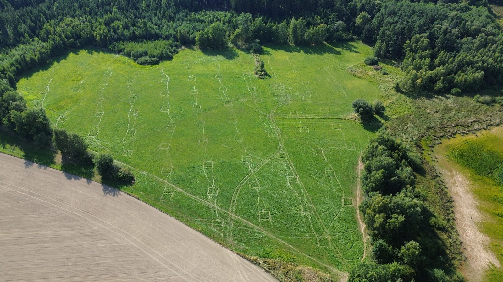

::: {.content-visible when-format="html"}
```{=html}
<div class="hero-section">
  
  <div class="hero-content">
    <h1>CESNET S3 &amp; Kubernetes Manuals</h1>
    <p>Pollination Ecology Group &middot; Handrkov Field Research &amp; Cloud Computing Hub</p>
    <a href="01_CESNET_S3_Storage_Manual.html" class="btn">1. S3 Storage Guide</a>
    <a href="03_Running_R_and_Python_Scripts_on_K8s.html" class="btn" style="margin-left: 10px;">3. Run R &amp; Python on K8s</a>
  </div>
</div>

<div class="handrkov-card" style="text-align: center; max-width: 780px;">
  <div class="handrkov-card-bar"></div>
  <h3 style="color: #354e6b; font-weight: 700; margin-top: 6px; margin-bottom: 12px; font-size: 1.35rem;">
    Quick Start for Colleagues
  </h3>
  <p style="color: #495057; margin-bottom: 18px; font-size: 1.05rem;">
    All raw datasets, microscopy scans, and model outputs are stored on <strong>CESNET S3 (<code>peg-bucket</code>)</strong>, while heavy R/Python analyses, GPU training, and web apps run on <strong>CERIT-SC Kubernetes (<code>stenc-ns</code>)</strong>.
  </p>
  <a href="02_Kubernetes_Getting_Started.html" class="btn">Set Up Rancher &amp; kubectl</a>
</div>
```
:::

# What is CESNET (e-INFRA CZ) & Why Do We Use It?

**CESNET** (part of the Czech national academic infrastructure **e-INFRA CZ**, together with **CERIT-SC** and **MetaCentrum**) provides cloud storage, high-performance computing, and GPU clusters **free of charge** to all researchers and students at Czech universities (Charles University) and the Czech Academy of Sciences (CAS).

Instead of storing terabytes of photos on external USB drives or letting long R/Python scripts freeze our personal laptops for days, our group uses two core CESNET services that work together:

1. **Central Group Data Storage — CESNET S3 (`peg-bucket`):**
   * **What it is:** A shared, terabyte-scale cloud object storage system (`https://s3.cl4.du.cesnet.cz`).
   * **Why use it:** High-resolution microscopy scans (`.czi`), pollinator camera recordings, and multi-year field datasets are too large for laptops, email, or standard Google Drive quotas. On CESNET S3, everyone in the group can access the same organized datasets from Windows, macOS, Linux, or directly inside R and Python scripts without duplicating files on their own hard drive.
2. **Cloud Compute & GPU Cluster — CERIT-SC Kubernetes (`kuba-cluster` / `stenc-ns`):**
   * **What it is:** A container cluster managed through a web dashboard ([rancher.cloud.e-infra.cz](https://rancher.cloud.e-infra.cz)) and the `kubectl` command-line tool.
   * **Why use it:**
     * **Run heavy R & Python scripts in the background:** Allocate up to **32 CPU cores and 64 GiB RAM** (per personal namespace) for null-model network simulations, Bayesian models (`brms`/`Stan`), or large data aggregations—and turn off your laptop while the cluster works.
     * **Train Deep Learning models on fast NVIDIA GPUs:** Request enterprise GPUs (NVIDIA A40, A100, H100) for computer vision pipelines (YOLO pollen detection, hoverfly tracking, stomata & root segmentation) that would take weeks on a CPU.
     * **Host 24/7 Web Apps for the Team:** Run interactive web tools (such as our Pollen, Stomata, Fly, and RhizoPic labeling/review apps, or R Shiny / Streamlit dashboards) with public `https://*.dyn.cloud.e-infra.cz` links so collaborators and students can annotate data directly in their browser.

### Which Tool Do I Need?

| Your Goal | What to Use | Where to Start |
| :--- | :--- | :--- |
| **"I just want to browse, download, or back up project files & photos"** | CESNET S3 via Cyberduck / WinSCP (GUI) or `rclone` / `s3fs` | [Manual 1: S3 Storage](01_CESNET_S3_Storage_Manual.html) |
| **"I want my R or Python script on my laptop to load data directly from our group storage"** | `aws.s3` (R) or `boto3` (Python) connected to `peg-bucket` | [Manual 1 (Section 6)](01_CESNET_S3_Storage_Manual.html#method-d-reading-writing-directly-from-r-and-python) |
| **"My R/Python script is too slow, needs 16–64 GB RAM, or I want to run it overnight"** | CERIT-SC Kubernetes CPU Job (`run_script_on_k8s.sh`) | [Manual 2](02_Kubernetes_Getting_Started.html) & [Manual 3](03_Running_R_and_Python_Scripts_on_K8s.html) |
| **"I need an NVIDIA GPU to train or run a YOLO / PyTorch model"** | CERIT-SC Kubernetes GPU Job (`python-gpu-job.yaml`) | [Manual 3 (Section 4)](03_Running_R_and_Python_Scripts_on_K8s.html#step-by-step-running-a-gpu-job-yolo-pytorch-deep-learning) |
| **"I want to publish an interactive web app, review tool, or Shiny/Streamlit dashboard"** | Kubernetes `Deployment` + `Service` + HTTPS `Ingress` | [Manual 4: Web Apps](04_Deploying_Web_Apps_on_K8s.html) |

---

# Manual Suite Overview

| Manual | Markdown | HTML | PDF | What It Covers |
| :--- | :--- | :--- | :--- | :--- |
| **1. CESNET S3 Storage** | [`01_CESNET_S3_Storage_Manual.md`](01_CESNET_S3_Storage_Manual.md) | [`HTML`](01_CESNET_S3_Storage_Manual.html) | [`PDF`](01_CESNET_S3_Storage_Manual.pdf) | GUI access (Cyberduck / WinSCP), mounting as a local folder (`s3fs`), fast bulk transfers (`rclone` / `aws-cli`), and direct **R** (`aws.s3`) & **Python** (`boto3`) integration. |
| **2. Kubernetes Getting Started** | [`02_Kubernetes_Getting_Started.md`](02_Kubernetes_Getting_Started.md) | [`HTML`](02_Kubernetes_Getting_Started.html) | [`PDF`](02_Kubernetes_Getting_Started.pdf) | Rancher login (`rancher.cloud.e-infra.cz`), `kubeconfig.yaml` setup, installing `kubectl`, mandatory CERIT-SC non-root security rules, and the `kubectl` cheat sheet. |
| **3. Running R & Python Scripts** | [`03_Running_R_and_Python_Scripts_on_K8s.md`](03_Running_R_and_Python_Scripts_on_K8s.md) | [`HTML`](03_Running_R_and_Python_Scripts_on_K8s.html) | [`PDF`](03_Running_R_and_Python_Scripts_on_K8s.pdf) | Running `.R` and `.py` scripts on CPU or NVIDIA GPUs **without building Docker images** (`ConfigMap` + `Secret`), S3 data syncing, and interactive debugging pods. |
| **4. Deploying Web Apps** | [`04_Deploying_Web_Apps_on_K8s.md`](04_Deploying_Web_Apps_on_K8s.md) | [`HTML`](04_Deploying_Web_Apps_on_K8s.html) | [`PDF`](04_Deploying_Web_Apps_on_K8s.pdf) | Hosting Flask/Waitress, Streamlit, or R Shiny dashboards with automatic HTTPS (`*.dyn.cloud.e-infra.cz`) and zero-downtime updates. |

---

# Ready-to-Use Templates (`templates/`)

You do not need to write configuration files from scratch. Copy and adapt the templates in the `templates/` folder:

## S3 Storage Templates (`templates/s3/`)
* **[`templates/s3/mount_cesnet_s3.sh`](templates/s3/mount_cesnet_s3.sh)** — Mounts or unmounts the `peg-bucket` S3 storage as a local folder (`~/cesnet_s3`) on Linux/macOS via `s3fs`.
* **[`templates/s3/rclone_backup_template.sh`](templates/s3/rclone_backup_template.sh)** — High-speed parallel upload/backup script using `rclone copy` (safe against accidental deletions).
* **[`templates/s3/s3_example.R`](templates/s3/s3_example.R)** — Complete R script showing how to list files, read/save `.rds` and `.csv` objects directly in memory, and upload/download files using `aws.s3`.
* **[`templates/s3/s3_example.py`](templates/s3/s3_example.py)** — Complete Python script using `boto3` and `pandas` to list, stream, download, and upload files to `peg-bucket`.

## Kubernetes Templates (`templates/k8s/`)
* **[`templates/k8s/run_script_on_k8s.sh`](templates/k8s/run_script_on_k8s.sh)** — **One-command launcher**: pass any local `.R` or `.py` file (`./run_script_on_k8s.sh my_script.R` or `./run_script_on_k8s.sh train.py --gpu`) and it automatically uploads the script to a `ConfigMap`, submits a CERIT-SC compliant Job with S3 credentials, and streams live logs!
* **[`templates/k8s/r-cpu-job.yaml`](templates/k8s/r-cpu-job.yaml)** — YAML template for running R scripts (`rocker/tidyverse:4.4.1`) with S3 credentials and writable user library directory.
* **[`templates/k8s/python-cpu-job.yaml`](templates/k8s/python-cpu-job.yaml)** — YAML template for running Python CPU data-processing jobs (`python:3.12-slim`).
* **[`templates/k8s/python-gpu-job.yaml`](templates/k8s/python-gpu-job.yaml)** — YAML template for running GPU deep learning jobs (`ultralytics/ultralytics:latest` / PyTorch) with 4 GiB `/dev/shm` shared memory and S3 sync.
* **[`templates/k8s/web-app-deployment.yaml`](templates/k8s/web-app-deployment.yaml)** — Complete `Deployment` + `Service` + HTTPS `Ingress` manifest for hosting web applications on `*.dyn.cloud.e-infra.cz`.

---

# Architecture Overview: How CESNET S3 & Kubernetes Work Together

In our workflow, **Kubernetes compute pods are stateless** (when a job finishes, its temporary container disk disappears). Therefore, all persistent datasets, images, and model outputs live on **CESNET S3 Object Storage**:

```text
+-------------------------------------------------------------------------+
| Your Laptop / Workstation (Linux, Windows, macOS)                       |
|  * Browse/upload files via Cyberduck, WinSCP, s3fs, or rclone           |
|  * Submit R / Python scripts to K8s via `kubectl`                       |
+-------------------+-------------------------------------+---------------+
                    |                                     |
        1. Upload data /                       2. Submit Job / ConfigMap
        Read final results                     (`kubectl apply -f ...`)
                    |                                     |
                    v                                     v
+---------------------------------------+     +---------------------------+
| CESNET S3 Object Storage              |     | CESNET / CERIT-SC K8s     |
| * Endpoint: https://s3.cl4.du.cesnet.cz|<--->| * Rancher: kuba-cluster   |
| * Bucket:   peg-bucket                | 3.  | * Namespace: stenc-ns     |
| * Legacy:   s3-old.cl4.du.cesnet.cz   |Pull | * Runs CPU & GPU Jobs     |
|             (bucket)                  |&    |   and Web Apps            |
+---------------------------------------+Push +---------------------------+
```

## Quick Reference Table (Group Defaults)

| Parameter | Value | Notes |
| :--- | :--- | :--- |
| **Primary S3 Endpoint** | `https://s3.cl4.du.cesnet.cz` | Current production CESNET CL4 Ceph S3 endpoint |
| **Primary S3 Bucket** | `peg-bucket` | Pollination Ecology Group shared bucket |
| **Legacy S3 Endpoint / Bucket** | `https://s3-old.cl4.du.cesnet.cz` / `bucket` | Older storage cluster (use only if migrating legacy files) |
| **Rancher Web Dashboard** | `https://rancher.cloud.e-infra.cz` | Log in via eduID.cz (Charles University / CAS) |
| **Kubernetes Cluster** | `kuba-cluster` | Download `kubeconfig.yaml` from Rancher |
| **Kubernetes Namespace** | `stenc-ns` | Default namespace for our group's jobs, secrets, and apps |
| **K8s S3 Credentials Secret** | `s3-credentials` | Pre-configured Secret in `stenc-ns` (`access-key` & `secret-key`) |

